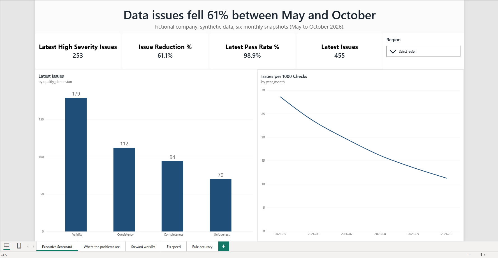
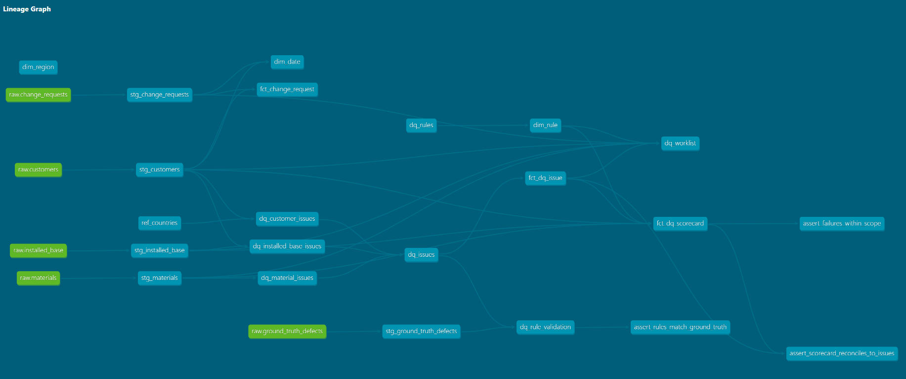
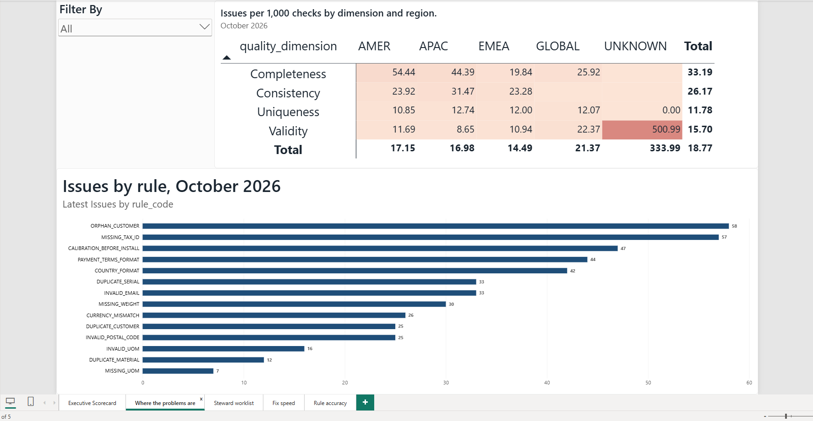
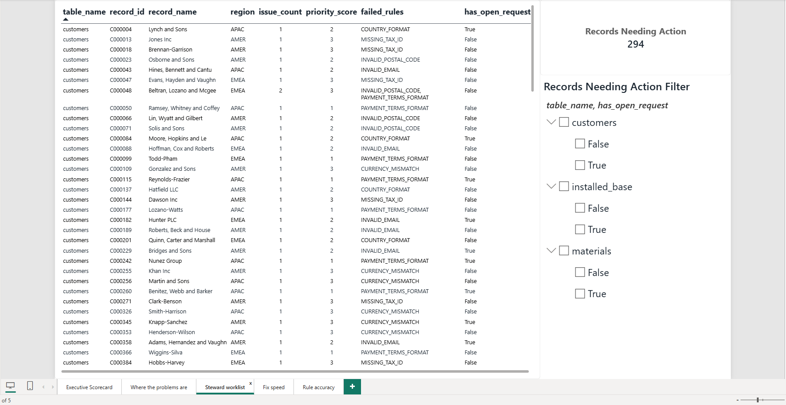
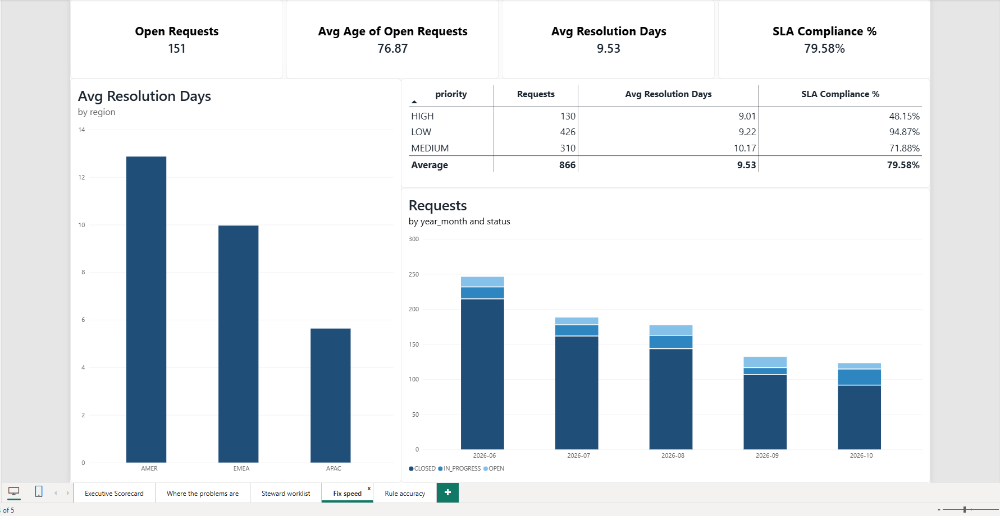
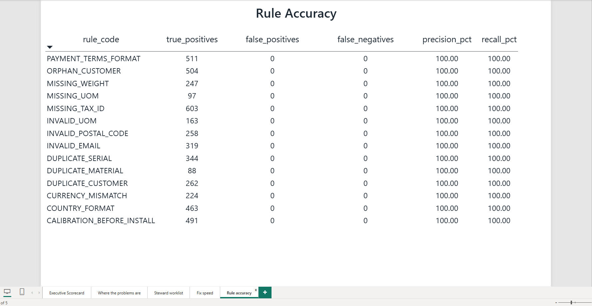

# Instrument Master Data Quality Pipeline

An end-to-end data quality pipeline for **synthetic** master data of a fictional precision-instruments manufacturer ("Acme Precision Instruments"). It generates realistic data with deliberate defects, detects them with a catalog of 14 rules, scores quality over six monthly snapshots, tracks how fast data stewards fix issues, and serves everything in a Power BI dashboard.

> All data is fake (generated with Faker). No real company or customer data is used.



## The scenario
Customer, material and installed-instrument records pile up defects: duplicate accounts, missing tax IDs, inconsistent country codes, instruments linked to customers that don't exist. A data governance team needs to **measure** quality, **prioritize** what to fix, and **track** how fast it gets fixed.

## Business questions
1. **How healthy is our master data?** Quality scores by dimension and region, and the trend over six months.
2. **Where are the worst problems?** Top issues by rule, a heatmap by dimension and region, and a prioritized worklist of records.
3. **How fast do we fix them?** Change-request volume, resolution time and SLA compliance by region and priority.

## Results (on the synthetic dataset)
- Open issues fell from **1,170 to 455 (-61%)** between May and October 2026; the overall check pass rate rose from **97.14% to 98.87%**.
- In the latest snapshot, **253 of 455 open issues are high severity**; validity (179) and consistency (112) are the biggest problem areas.
- All **14 rules detect the 4,574 injected defects with 0 false positives and 0 false negatives**.
- 294 records still have issues but no open change request.

*The defect rates and steward behavior were set by the data generator, so these results demonstrate the measurement approach, not real-world findings.*

## Architecture


| Layer | Tool | What it does |
|---|---|---|
| Generate | Python, Faker | Builds customers, materials, installed base, change requests, plus a ground-truth list of injected defects; six monthly snapshots; fixed seed so results are repeatable |
| Load | Python, SQLAlchemy | Loads CSVs as text into `raw` (truncate and refill, never drop) |
| Staging | dbt | Renames and casts types. It deliberately does **not** repair data, so defects survive to be measured |
| Quality rules | dbt SQL + seeds | 14 rules output one row per failing record per snapshot |
| Marts | dbt | Star schema: dimensions, issue fact, scorecard fact, change-request fact, steward worklist |
| BI | Power BI Desktop | 5 pages, 20 DAX measures |



## Data quality framework
Four quality dimensions, 14 rules, each with a severity (High = 3, Medium = 2, Low = 1 priority points):

| Rule | Table | Dimension | Severity |
|---|---|---|---|
| MISSING_TAX_ID | customers | Completeness | High |
| MISSING_UOM | materials | Completeness | High |
| MISSING_WEIGHT | materials | Completeness | Medium |
| INVALID_EMAIL | customers | Validity | Medium |
| INVALID_POSTAL_CODE | customers | Validity | Medium |
| INVALID_UOM | materials | Validity | Medium |
| ORPHAN_CUSTOMER | installed_base | Validity | High |
| CALIBRATION_BEFORE_INSTALL | installed_base | Validity | High |
| COUNTRY_FORMAT | customers | Consistency | Medium |
| CURRENCY_MISMATCH | customers | Consistency | High |
| PAYMENT_TERMS_FORMAT | customers | Consistency | Low |
| DUPLICATE_CUSTOMER | customers | Uniqueness | High |
| DUPLICATE_MATERIAL | materials | Uniqueness | Medium |
| DUPLICATE_SERIAL | installed_base | Uniqueness | High |

**Scoring:** every record checked against a rule is one check. Pass rate = 1 - failed checks / checks performed. Because pass rates move only slightly (97% to 99%), the dashboard headlines use issue counts and issues per 1,000 checks.

## Data model
- **Facts:** `fct_dq_issue` (record x rule x snapshot), `fct_dq_scorecard` (snapshot x rule x region), `fct_change_request`
- **Dimensions:** `dim_date`, `dim_rule`, `dim_region`
- **Steward queue:** `dq_worklist` (failing records in the latest snapshot, ranked by severity-weighted priority score)

## Engineering highlights
- **Detect, never repair.** Staging only casts types. Rules normalize values (for example map `PHL` or `Philippines` to `PH`) inside the rule only, so the underlying data stays untouched.
- **Rules produce rows, tests produce pass/fail.** dbt tests guard the pipeline (keys, accepted values, relationships); the rule models output countable issues that feed the scorecard.
- **Rules are validated against ground truth.** The generator records every injected defect; `dq_rule_validation` compares detected vs injected issues per rule, and a dbt test fails the build if any rule drops below 95% precision or recall. (100% is expected here because rules and generator were designed together; on real data accuracy would be measured through steward feedback and sampling.)
- **Reconciliation tests.** The scorecard's failed-check total must equal the number of issues, and failures can never exceed checks performed.
- **Business-rule nuance.** Services legitimately have no weight, so the weight rule only checks physical items.
- **Idempotent, repeatable runs.** The loader truncates and refills tables (so dbt views keep working); the generator uses a fixed seed.

## Dashboard pages
| | |
|---|---|
|  |  |
|  |  |

The Power BI file is in [`powerbi/mdq_dashboard.pbix`](powerbi/mdq_dashboard.pbix) and the DAX is in [`powerbi/dax_measures.md`](powerbi/dax_measures.md).

## How to run
**Prerequisites:** Python 3.12+, Docker Desktop, Power BI Desktop (Windows, optional).

```powershell
git clone https://github.com/juicewant/instrument-master-data-quality.git
cd instrument-master-data-quality
python -m venv .venv
.\.venv\Scripts\Activate.ps1
pip install -r requirements.txt

copy .env.example .env            # then set POSTGRES_PASSWORD in .env
docker compose up -d              # PostgreSQL on port 5433

python generator/generate_data.py
python generator/load_to_postgres.py

cd dbt_project                    # run dbt from inside this folder
dbt build                         # seeds, models and tests
```
Then open `powerbi/mdq_dashboard.pbix`, point the PostgreSQL connection at `localhost:5433` (database `mdq`), and refresh. The dbt profile defaults match the `.env.example` values; for a different password, set `POSTGRES_PASSWORD` as an environment variable before running dbt.

## Project structure
```
├── generator/                 # synthetic data generator and loader
├── dbt_project/
│   ├── seeds/                 # country reference data and the rule catalog
│   ├── models/staging/        # type casting only
│   ├── models/quality/        # the 14 rules, combined issues, rule validation
│   ├── models/marts/          # star schema, scorecard, steward worklist
│   └── tests/                 # reconciliation and rule-accuracy tests
├── powerbi/                   # .pbix, theme and DAX measures
├── docs/images/               # screenshots
└── docker-compose.yml         # PostgreSQL
```

## Limitations and next steps
- Duplicate detection uses normalized exact matching, not fuzzy matching.
- Orphan instruments have no customer, so their region is `UNKNOWN`, which inflates that column's issues-per-1,000 rate on the heatmap.
- SLA targets (7, 14 and 21 days by priority) are assumptions.
- Next: dbt snapshots for history, scheduled runs, CI on pull requests, and comparing with a data quality tool such as Great Expectations or Soda.

## Data and attribution
Synthetic data generated with [Faker](https://faker.readthedocs.io). Any resemblance to real companies is coincidental.